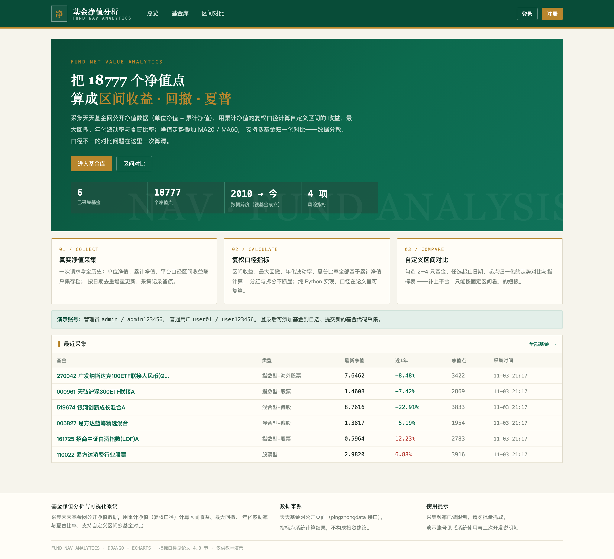
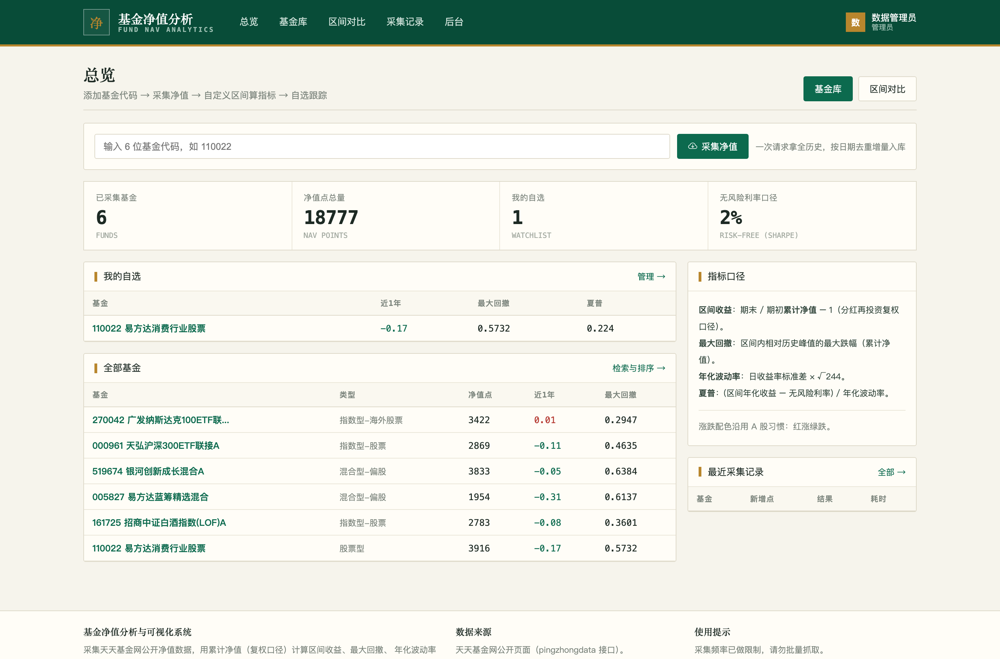
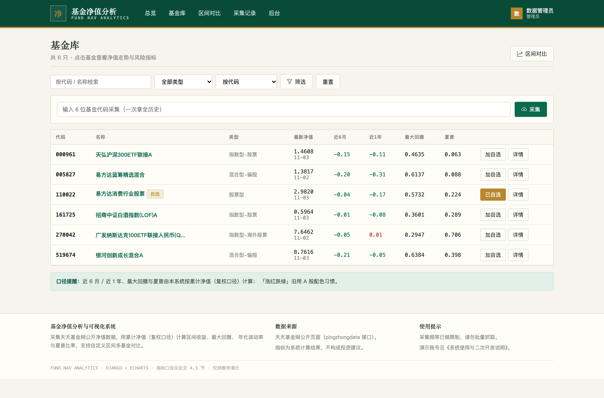
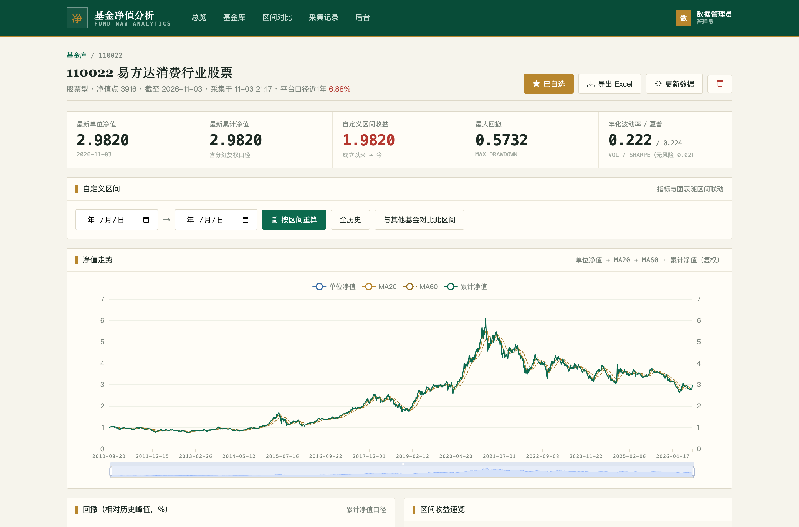
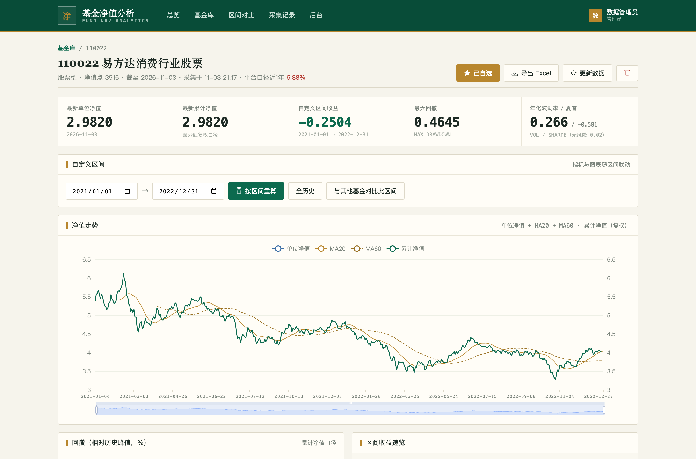
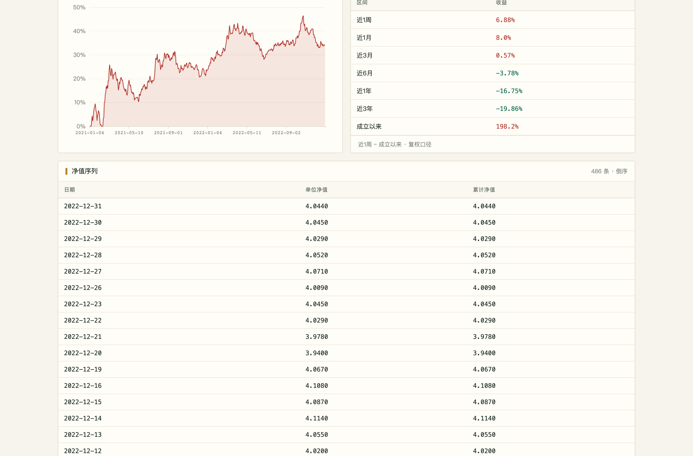
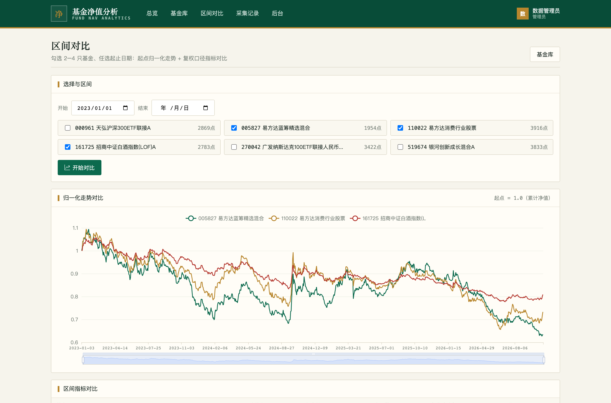
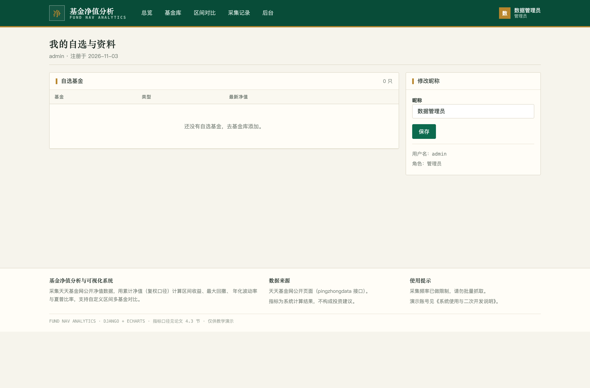
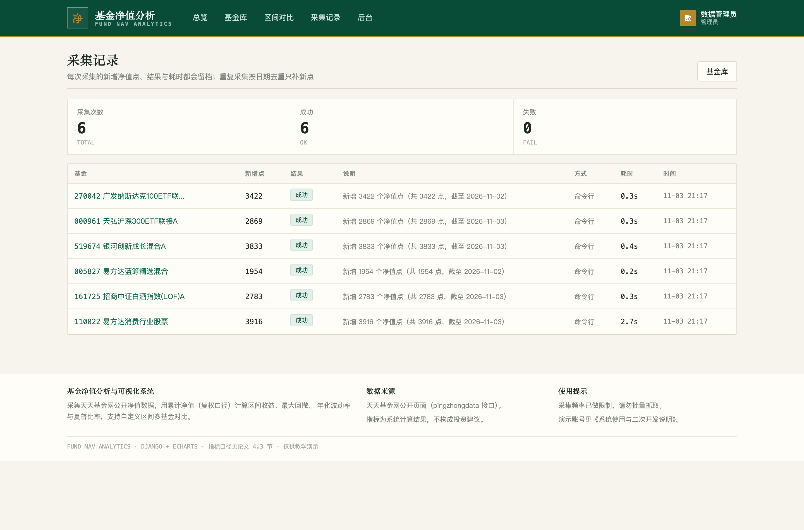
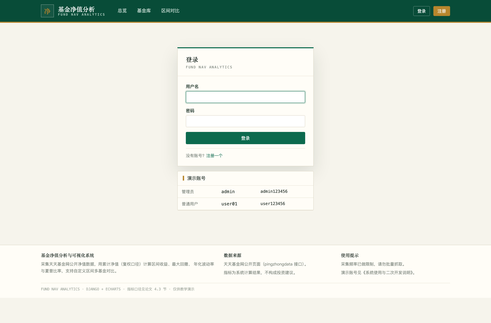

# 010 基于 Django 的基金净值分析与可视化系统-设计展示

> **代码有偿获取 可接受定制 微信联系方式: csbysj2020 或 ACE2487，备注(BS)**

> **完整源码与全套文档 · 在线自助获取 >>> [https://mbd.pub/o/bread/YZaWlJ1uZg==](https://mbd.pub/o/bread/YZaWlJ1uZg==)**

> **成品页（功能介绍 / 更多选题）>>> [https://bishe.suilang.net/products/django-fund-nav-analytics](https://bishe.suilang.net/products/django-fund-nav-analytics)**

> 

> 

## 视频

> **点击查看 >>> [https://www.bilibili.com/video/BV1z54G6vEHP/](https://www.bilibili.com/video/BV1z54G6vEHP/)**

## 项目简介

面向基金投资者的净值分析与对比工具：采集天天基金网公开净值数据（一次请求拿全历史单位净值 + 累计净值），以累计净值的复权口径计算自定义区间的收益、最大回撤、年化波动率与夏普比率；净值走势叠加 MA20 / MA60 与回撤面积图，支持多基金起点归一化对比、自选跟踪与 Excel 导出。

公募基金数量已超过一万只，投资者对比产品时普遍面临两个问题：平台只提供固定区间的收益展示，无法按自己的持有周期自定义对比；分红与拆分造成单位净值「跳水」，直接用单位净值计算收益会明显失真，而各平台的指标口径又不透明、难以复算。

针对这些问题，本项目设计并实现了一套基于 Django 的基金净值分析与可视化系统。

系统采集天天基金网公开的净值数据（pingzhongdata 接口一次请求即返回全历史的单位净值趋势、累计净值趋势与平台口径区间收益，无需登录），按「基金 + 日期」唯一约束去重增量入库；指标计算模块以纯 Python 实现区间收益、最大回撤、年化波动率与夏普比率，全部采用累计净值的复权口径——累计净值将分红加回，等价于红利再投资，分红与拆分不再造成断崖；期初期末取「指定日期当日或之前最后一个净值日」，消除非交易日带来的口径歧义。

本仓库为**设计展示**：包含项目说明、技术架构、实验结果与运行截图；完整源码、任务书、开题报告、毕业论文与使用说明可通过上方链接自助获取，成品页可查看更多选题，也可联系微信咨询定制。

## 功能特性

1. 真实净值采集：天天基金网 pingzhongdata 接口一次拿全历史（2010 → 今），按（基金，日期）去重增量入库

2. 复权口径指标：区间收益、最大回撤、年化波动率、夏普比率全部基于累计净值，分红与拆分不断崖

3. 自定义区间：任选起止日期，指标卡与图表联动重算；期初期末自动对齐到最后一个净值日

4. 净值走势：单位净值 + MA20 + MA60 + 累计净值双轴，dataZoom 自由缩放

5. 回撤面积图：相对历史峰值的跌幅一目了然

6. 区间对比：2–4 只基金起点归一化走势 + 复权口径指标表横向对比

7. 自选跟踪：登录用户自选清单，总览页展示近 1 年收益 / 回撤 / 夏普

8. 采集记录与导出：新增净值点 / 结果 / 耗时留档；概览与全量净值 Excel 导出

## 技术架构

| 项目 | 说明 |
| --- | --- |
| 编程语言 | Python 3.8 及以上 |
| Web 框架 | Django 4.2 |
| 数据采集 | 天天基金网公开接口（pingzhongdata，无需登录，限速采集） |
| 指标计算 | 纯 Python 自实现（无 numpy / pandas 依赖，口径可配置） |
| 数据库 | MySQL 5.7 及以上（交付默认 SQLite，免安装） |
| 可视化 | ECharts 5（已内置本地文件，离线可用） |
| 报表导出 | openpyxl |
| 操作系统 | Windows / macOS / Linux |
| 启动方式 | 双击一键脚本，或 python manage.py runserver |

## 目录结构

以下为完整交付版的结构（本仓库仅作设计展示）：

```
django-fund-nav-analytics/
├── 任务书/
│   └── 毕业设计任务书.docx
├── 开题报告/
│   └── 毕业设计开题报告.docx
├── 最终论文/
│   ├── 图/
│   │   ├── 图3-1_系统用例图.png
│   │   ├── 图4-1_系统架构图.png
│   │   ├── 图4-2_功能模块图.png
│   │   ├── 图4-3_指标计算流程图.png
│   │   ├── 图4-4_数据库ER图.png
│   │   └── 图4-5_净值采集流程图.png
│   └── 基于Django的基金净值分析与可视化系统设计.docx
├── 源码/
│   ├── accounts/
│   │   ├── migrations/
│   │   ├── __init__.py
│   │   ├── admin.py
│   │   ├── apps.py
│   │   ├── forms.py
│   │   ├── models.py
│   │   ├── urls.py
│   │   └── views.py
│   ├── analysis/
│   │   ├── __init__.py
│   │   ├── admin.py
│   │   ├── apps.py
│   │   ├── services.py
│   │   └── urls.py
│   ├── data/
│   │   └── fundcode_search.json
│   ├── fundplat/
│   │   ├── asgi.py
│   │   ├── settings.py
│   │   ├── urls.py
│   │   └── wsgi.py
│   ├── funds/
│   │   ├── management/
│   │   ├── migrations/
│   │   ├── __init__.py
│   │   ├── admin.py
│   │   ├── apps.py
│   │   └── …
│   └── …
└── …
```

## 数据与实验结论

- 可视化方面，净值走势图以单位净值、MA20、MA60 与累计净值双轴呈现并支持 dataZoom 缩放，回撤以相对历史峰值的面积图呈现；多基金对比将各序列按公共日期起点归一化，配合复权口径的指标表横向比较。
- 测试结果表明：6 只不同类型基金共 18777 个净值点的采集与入库稳定，区间收益、最大回撤等指标与手工复算结果一致，自定义区间对比功能正确处理了分红日与非交易日边界，万级净值点的分析页面响应流畅，达到了设计目标。
- 真实净值采集：天天基金网 pingzhongdata 接口一次拿全历史（2010 → 今），按（基金，日期）去重增量入库
- 净值走势：单位净值 + MA20 + MA60 + 累计净值双轴，dataZoom 自由缩放

## 交付内容

1. 完整源码（已跑通，含 6 只基金、18777 个真实净值点的演示库）
2. 可独立复用的采集模块与指标计算模块（纯函数，口径可配置）
3. 毕业设计任务书（Word）
4. 开题报告（Word）
5. 毕业论文（Word，七章制，含指标口径设计章节）
6. 系统使用与二次开发说明（Word + md）
7. 10 张系统运行截图

## 常见问题

**项目能直接跑起来吗？**

能。交付包里已带数据库（6 只基金、18777 个真实净值点），安装依赖后双击一键脚本即可；采集新基金需要联网，无需登录。

**数据是真实的吗？**

净值与平台口径收益来自天天基金网公开接口，真实采集；区间收益 / 回撤 / 波动率 / 夏普是本系统按累计净值计算的复权口径，论文公开了全部公式。

**为什么用累计净值而不是单位净值？**

分红日单位净值会「跳水」，直接算收益会低估；累计净值把分红加回，等价于红利再投资的复权口径。页面底部有专门说明。

**区间收益为什么和平台显示的不一样？**

平台多为固定区间 + 单位净值口径；本系统支持自定义区间 + 复权口径，两者口径不同，页面上分别标注。

**最大回撤和夏普是怎么算的？**

回撤 = 区间内相对历史峰值的最大跌幅；波动率 = 日收益标准差 × √244；夏普 = (区间年化收益 − 无风险利率) / 波动率，无风险利率默认 2% 可配置。

**非交易日选成开始日期怎么办？**

期初期末自动取「当日或之前最后一个净值日」，消除周末与节假日的取数歧义。

## 截图











